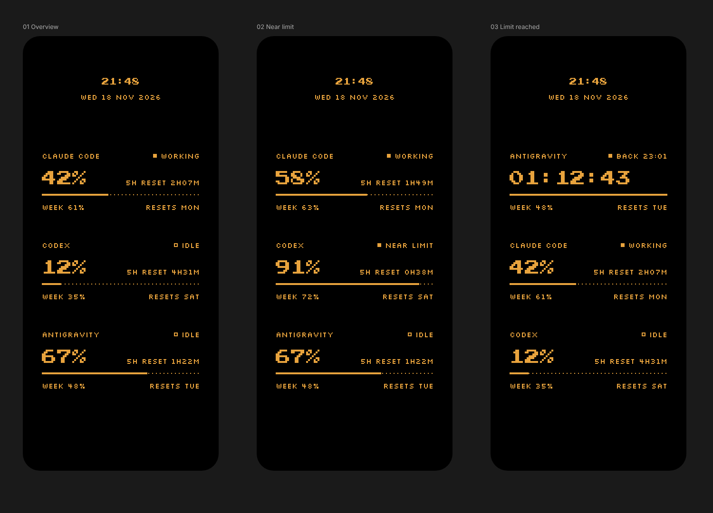

# agent-usage

An **Android** always-on style display for the usage limits of your coding agents: **Claude
Code**, **Codex** and **Antigravity**. Amber pixel type on pure black, minimal, made for OLED.

- **Design:** [`design/README.md`](design/README.md) · preview: open [`design/preview/v2-minimal.html`](design/preview/v2-minimal.html) in a browser
- **How it works:** [`docs/architecture.md`](docs/architecture.md). A collector on your computer reads each agent's limits and the phone displays them.
- **Where the numbers come from:** [`docs/data-sources.md`](docs/data-sources.md)
- **Plan:** [`docs/roadmap.md`](docs/roadmap.md)
- **For coding agents:** [`AGENTS.md`](AGENTS.md) (Claude Code reads it via `CLAUDE.md`)

Status: design done, Android app not started yet (next: milestone M0 in the roadmap).
Android only, with no iOS version planned.

## Tóm tắt (VI)

App **chỉ cho Android**, hiển thị hạn mức sử dụng (cửa sổ 5 giờ và hạn mức tuần) của
Claude Code, Codex và Antigravity. Màn hình hiện chữ pixel màu hổ phách trên nền đen,
theo kiểu always-on.

- Thiết kế hiện tại là **V2 Minimal**. Bản **V1 LED** được giữ lại để tham khảo.
- Android không cho app bên thứ ba thay màn AOD của hệ thống, nên app có hai chế độ thay thế:
  - **Standby:** màn hình đen toàn màn hình, luôn sáng.
  - **Screen saver:** hiện khi điện thoại đang sạc.
- Số liệu do một **collector** chạy trên máy tính đọc rồi gửi qua mạng LAN. Token của các
  agent không bao giờ rời máy tính.
- Bắt đầu phát triển: đọc `AGENTS.md`, rồi làm theo `docs/roadmap.md` từ M0.

## Licences

Code: see [`LICENSE`](LICENSE). Fonts in `design/fonts/` are under the SIL Open Font
License ([Press Start 2P](design/fonts/OFL-pressstart2p.txt), [Silkscreen](design/fonts/OFL-silkscreen.txt)).
