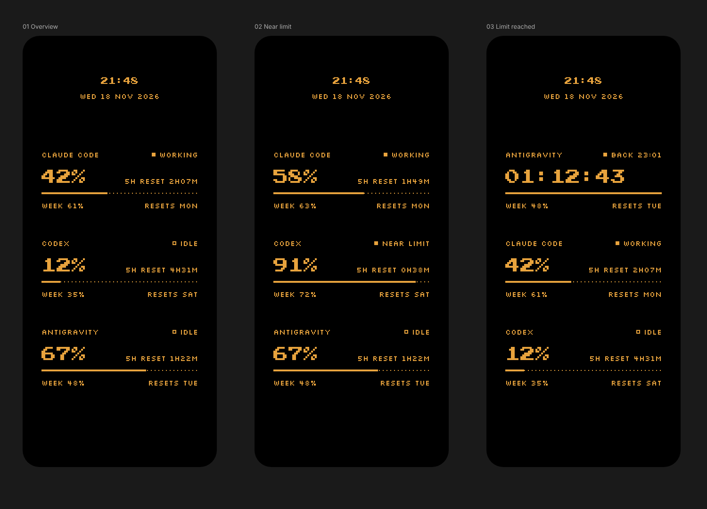

# Design — Agent Usage AOD

An always-on style screen for Android that shows the current usage limits of the
coding agents in use: **Claude Code**, **Codex** and **Antigravity**.

- **Current design:** V2 "Minimal". Its look is described in this file, and
  [`preview/v2-minimal.html`](preview/v2-minimal.html) shows it (open it in a browser, works offline).
- **Backup:** V1 "LED" (dashed dividers, cell bars, glow). Its source is kept in
  [`source/v1-led/`](source/v1-led/) for reference only. Do not build from it.
- **Design canvas:** https://claude.ai/code/artifact/2544d41f-0d13-4ce0-b9b5-1c39c4fdbac7
  (owner-only). The `.dc.html` files in [`source/`](source/) are exports of
  that canvas. They need the canvas runtime (`support.js`) to render, so use the
  HTML preview instead when you want to look at the design.

All numbers in the design are **sample data**.



---

## 1. Principles

1. **Two colours only:** amber text and marks on pure black. Black pixels are off on OLED,
   which is the point of an always-on screen.
2. **8-bit, but crisp:** pixel fonts, square ends and no glow, blur, gradients or rounded bars.
3. **Minimal, Apple-like restraint:** whitespace does the separating. No dividers, no footer,
   no extra labels, and one hero number per agent.
4. **Same block for every agent:** adding an agent means adding one more data entry. The
   layout must not need to change.

## 2. Tokens

| Token | Value | Notes |
|---|---|---|
| `color.ink` | `#E8A33D` | Amber. The user may pick an alternative tint: `#FFB000`, `#C98A2E`, `#F2C14E`. |
| `color.ground` | `#000000` | Pure black; never dark grey. |
| `font.display` | Press Start 2P | Numbers, clock and countdown. OFL licence, file in [`fonts/`](fonts/). |
| `font.text` | Silkscreen (Regular) | Names, statuses, labels. OFL licence, file in [`fonts/`](fonts/). |
| `size.text` | 16 | Every label. |
| `size.hero` | 32 | Hero number or countdown. |
| `size.clock` | 16 | Time (Press Start 2P) and date (Silkscreen). |
| `grid` | 8 | All spacing is a multiple of 8, except the 4 px bar. |

Sizes are in the 412 × 915 reference frame (CSS px ≈ Android dp).

### The crisp-pixel rule (important)

Both fonts are drawn on a **grid of 8 font-pixels per em**. Checked from the font files:
`unitsPerEm = 1000`, and every outline and advance is a multiple of 125. Text is only sharp
when **one font-pixel lands on a whole number of device pixels**:

```
fontSizePx = 8 × k        (k = whole number of device px per font-pixel)
```

That is why V2 uses only 16 and 32, and dropped the 12 and 14 that V1 used. On Android, dp
values are multiplied by the screen density (for example 2.625), so `16.dp` does *not* give an
exact multiple of 8. Pick device-pixel sizes yourself; see `AGENTS.md` → "Pixel-perfect text".

Both fonts are **Latin only**. They have no Vietnamese diacritics, so all on-screen copy stays
uppercase English.

## 3. Layout (reference frame 412 × 915)

```
┌──────────────────────────────┐  padding: top 88, sides 40, bottom 64
│            21:43             │  Press Start 2P 16
│       WED 18 NOV 2026        │  Silkscreen 16, 16 below the time
│                              │
│ CLAUDE CODE        ■ WORKING │  name ··· status (status dot 8×8, gap 8)
│                              │  8 extra
│ 42%           5H RESET 2H07M │  hero 32 ··· sub 16 (bottom-aligned)
│ ▬▬▬▬▬▬▬▬▬ · · · · · · · · ·  │  bar 4 high: fill solid; track = 2×2 dots every 8
│ WEEK 61%          RESETS MON │
│                              │  64 between agent blocks
│ CODEX                 □ IDLE │
│ …                            │
└──────────────────────────────┘
```

- Content width is 332 (412 − 2 × 40).
- The agent list fills the space under the clock and is **vertically centred**.
- Inside a block, the gap between rows is 16, plus 8 extra under the name row.
- **Bar:** the fill is a solid 4 px rectangle. The track is a 2 px high line of 2 px dots on an
  8 px pitch, centred vertically (top offset 1). Snap the fill width to an even number of device
  pixels.
- No footer, dividers, logos or icons other than the status dot.

## 4. Agent block — states

| State | When | Status (right of name) | Hero | Hero sub |
|---|---|---|---|---|
| `working` | Agent active in the last ~60 s | filled dot, **blinking**, `WORKING` | 5H % | `5H RESET 2H07M` |
| `idle` | Not active | outlined dot (2 px stroke), `IDLE` | 5H % | `5H RESET …` |
| `near_limit` | 5H ≥ 85 % (configurable) | filled dot, blinking, `NEAR LIMIT` | 5H % | `5H RESET …` |
| `limited` | Any window ≥ 100 % | filled dot, blinking, `BACK HH:MM` | **countdown** `HH:MM:SS` | — (empty) |
| `no_five_hour` | Plan has no 5H window (e.g. some Codex plans) | as above | WEEK % | `WEEK` |
| `stale` | No fresh data for > 15 min | outlined dot, `OLD 23M` (age of data) | last known 5H % | last known sub |
| `unknown` | Never received data | outlined dot, `NO DATA` | `--%` | — |

Footer row of each block: `WEEK 61%` on the left and `RESETS MON` on the right.

- Only the **dot** blinks (1.2 s period, 50 % duty, hard on/off with no fade). Text never
  blinks. Provide a setting to turn blinking off.
- The blink appears only when something needs attention or is active, so idle screens stay
  still.

## 5. Ordering and count

- Any `limited` agent is listed first, then the user's chosen order (default: Claude Code, Codex, Antigravity).
- The block works for 1 to 4 agents; with 3 or fewer the vertical centring keeps it balanced.
- Each agent can be hidden in settings.

## 6. Copy

- Uppercase English only (font coverage).
- Time is 24-hour `HH:MM`. Date is `DDD DD MMM YYYY` (e.g. `WED 18 NOV 2026`).
- Durations: `2H07M`, `0H38M`. Weekdays: `MON`…`SUN`.
- Agent names: `CLAUDE CODE`, `CODEX`, `ANTIGRAVITY`.

## 7. Screens in the canvas

| Canvas page | Artboard | Shows |
|---|---|---|
| V2 Minimal | 01 Overview | 3 agents, Claude Code working |
| V2 Minimal | 02 Near limit | Codex at 91 % → `NEAR LIMIT` |
| V2 Minimal | 03 Limit reached | Antigravity limited → countdown, moved to top |
| V1 LED (backup) | 01–03 | Earlier LED-panel exploration |
